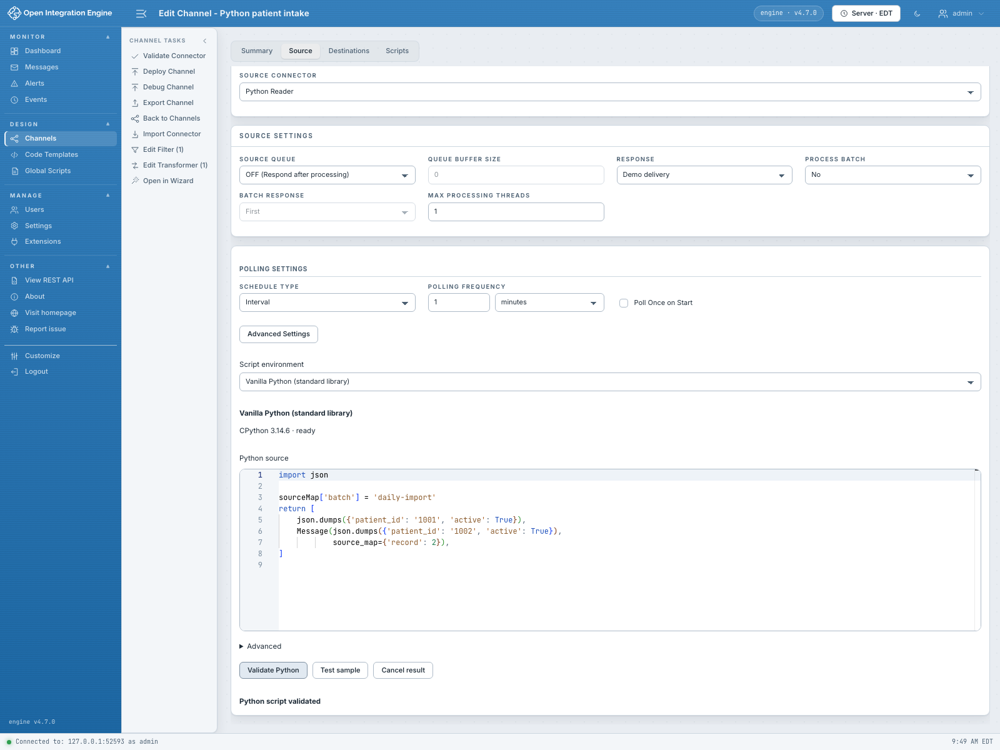
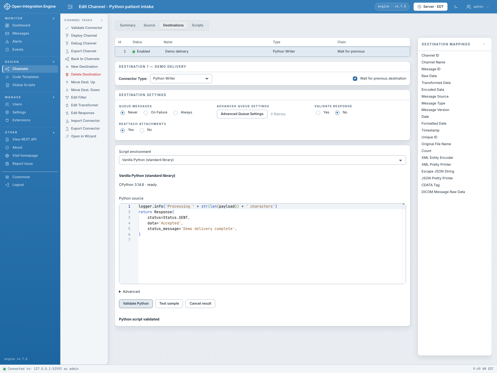

# Python Reader and Writer connectors

[Wiki home](Home.md) · [Contexts and message flow](Contexts-and-message-flow.md) · [Filters and transformers](Filters-and-transformers.md) · [Maps and values](Maps-and-values.md) · [Functions, classes and modules](Functions-classes-and-modules.md) · [Environments and deployment](Environments-and-deployment.md) · [Editor testing and troubleshooting](Editor-testing-and-troubleshooting.md)

Use a **Python Reader** to produce channel messages on the engine's polling schedule. Use a **Python Writer** to perform a destination operation and report its response to the engine. These are connector scripts; a Python transformer changes a message already being processed, and a response transformer changes an existing destination response.

Write the script body directly and return its output. The runtime handles function execution internally; no `main()`, `read()`, or `write()` entry point is required. A `return` exits immediately, with normal Python `finally` behavior. Imports, functions and classes are ordinary Python, and helper functions run only when you call them. All examples below use the bundled SDK and Python's standard library. They perform no external network calls.

The supported engine/editor baseline and qualification procedure are recorded in [validation](../validation.md). Connector editing is available in the Web Administrator; the Swing Administrator has placeholder panels. Select a prepared environment, save the channel and deploy it to use the saved script. See [environments and deployment](Environments-and-deployment.md) for profile readiness, node locality and deployment snapshots.

## Reader editor



The Reader panel shows polling settings, a ready environment, and source returning two SDK `Message` values with shared and per-message source-map entries. **Validate Python** has succeeded; this checks compilation and the environment without running the Reader. Use **Test sample** to preview returned messages before deploying the polling channel.

## Reader: one invocation per poll

A Reader receives these context variables:

| Name | Meaning |
| --- | --- |
| `sourceMap` | Fresh writable invocation-local map. A live invocation starts with `pollId`, a newly generated UUID string. Its final entries supply defaults for every returned `Message`. |
| `message` | Read-only connector metadata, described below. It is not a message body or Java object. |
| `phase` | `"reader"`. |
| `logger` | Bounded script logger with `debug`, `info`, `warning` and `error`. |
| `globalMap`, `globalChannelMap` | Writable snapshots of the engine's shared maps. |
| `configurationMap` | Read-only snapshot of engine configuration values. |

Live Reader `message` metadata has exactly these fields:

| Key | Value |
| --- | --- |
| `channel_id` | Channel UUID string. |
| `channel_name` | Channel name. |
| `connector_name` | Source connector name. |
| `metadata_id` | Source connector metadata ID, represented as a Python integer. |

There is no live `message_id`, `server_id`, `send_attempts` or `received_date` at this stage: no message has been admitted yet. `sourceMap.get('pollId')` identifies this invocation; it is not an external record ID or a durable cursor. Synthetic **Test** starts with `sourceMap` containing `pollId: "sample"`, and supplies sample message metadata rather than the live fields above. There is no `poll` script global. Use `message.get(...)` for optional message metadata.

An ordinary assignment such as `x = value` is local to this invocation. To carry a value downstream on every emitted message, set `sourceMap["x"] = value` or call `sourceMap.put("x", value)`. Rebinding `sourceMap` only changes the local script binding; extraction still uses the original supplied map. Each returned `Message` inherits its final values, with `Message.source_map` entries overriding matching keys for that message, including `pollId`. A following Python script reads the resulting read-only `sourceMap["x"]`, and JavaScript reads `sourceMap.get("x")`. The Reader map starts fresh for every invocation and does not preserve values for later polls. Use `globalChannelMap` or `globalMap` to share supported values with later polls, subject to the existing node-local lifetime and snapshot/concurrency rules; these maps are not durable checkpoints or atomic counters.

Readers do not have `msg`, `tmp`, `payload`, `response`, `channelMap`, `connectorMap`, `responseMap` or a live `connectorMessage`. Put common initial source values in the supplied writable `sourceMap`, and per-message overrides in each returned `Message.source_map`. The configured message-count limit and enabled destination ID set are enforced internally; they are not additional public script globals. See [maps and values](Maps-and-values.md) for supported value types and shared-map concurrency.

### Emit one message

Paste into a Python Reader:

```python
import json
sourceMap.put("origin", "python-reader")
body = json.dumps({"record_id": "example-001", "active": True})
return Message(
    body,
    source_map={"record_id": "example-001"},
    destination_ids=None,
)
```

Each live poll emits a new engine message. This fixed example deliberately repeats the same record ID each time; it does not implement a checkpoint or duplicate suppression. Configure the source data type to match the emitted body, such as JSON for this example. A downstream Python step can read `sourceMap.get('record_id')`.

To emit no work:

```python
return None
```

`return []` and `return ""` have the same effect. Falling through also emits nothing. Return a string for one plain text message, or a Python list mixing strings and `Message` objects for several messages:

```python
sourceMap["origin"] = "reader"
return ["one", "two", Message("routed", destination_ids=[2])]
```

Bare strings inherit the final `sourceMap` and select all enabled destinations. Empty bare strings are skipped, including within a list; `Message("")` emits a real empty message. A dictionary, generator, tuple of messages or bare bytes object is invalid. Use `Message(...)` for binary data or per-message metadata/routing.

### Message is Python's counterpart to RawMessage

`Message` is supplied automatically in Reader scripts. Explicit `from oie_python import Message` remains supported.

Its constructor is `Message(payload, source_map=None, destination_ids=None)`. The fields remain mutable until result extraction. There is no Python `RawMessage` alias or Java wrapper to import.

| JavaScript Reader / engine concept | Python Reader |
| --- | --- |
| Return a nonempty string | Return a nonempty string |
| `new RawMessage(text)` | `Message(text)` |
| Raw data | `Message.payload` |
| Source map passed to `RawMessage` | `Message.source_map` |
| Destination metadata ID collection | `Message.destination_ids` |
| Return a Java `List` of strings and/or `RawMessage` | Return a Python list of strings and/or `Message` |
| Return nothing / no messages | Return `None` or `[]`, or fall through |

Stock OIE 4.6/4.7 converts a Java `List` entry by entry; a native JavaScript array instead falls through to a single string conversion. Python uses its ordinary list for multiple messages. Python rejects other element types instead of implicitly calling `toString()`.

A JavaScript Reader example using the stock engine's wrapper:

```javascript
var initialValues = new java.util.HashMap();
initialValues.put('origin', 'reader');
return new RawMessage('{"record_id":"example-001"}', null, initialValues);
```

The Python equivalent:

```python
return Message(
    '{"record_id":"example-001"}',
    source_map={"origin": "reader"},
    destination_ids=None,
)
```

The argument order differs: JavaScript's three-argument `RawMessage` takes **payload, destination IDs, source map**. Python's `Message` takes **payload, source map, destination IDs**. Prefer Python keyword arguments to make that distinction explicit. Java engine bookkeeping such as attachments, original message IDs, and import/overwrite flags is not exposed by this Python type.

### Text, binary and empty payloads

`payload` must be a Python `str` or `bytes`; the SDK also normalizes `bytearray` and `memoryview` to bytes during extraction. Serialize JSON explicitly with `json.dumps`. A Python dictionary is not automatically converted into raw JSON.

```python
return [
    Message(""),
    Message(b"\x00\xff"),
]
```

Both entries are real messages. `Message('')` and `Message(b'')` also emit real messages; `None`, an empty result list and empty bare strings mean no work. Binary messages use the engine's raw-byte path and appear in its base64 representation, so `b'\x00\xff'` is observed as `AP8=` in raw text. Do not base64-encode bytes yourself merely to cross the Python boundary. Whether downstream processing should decode that text depends on the channel's data type and integration protocol.

**Disable Process Batch for binary payloads**, including empty bytes. A list containing a valid text message followed by a binary message is rejected in full when Process Batch is enabled.

### Initial source values and reserved keys

The supplied Reader `sourceMap` supports the ordinary map methods and Python dictionary operations described in [Maps and values](Maps-and-values.md). Its final entries are inherited by every returned message. A message's `source_map` defaults to a fresh empty dictionary and overrides those inherited entries. It must be a dictionary with string keys and supported values. Nested dictionaries/lists, finite numbers, booleans, strings, bytes and `None` are supported subject to the common value limits; arbitrary Python or Java objects are not. See [maps and values](Maps-and-values.md).

The following keys belong to the engine and are rejected as top-level keys in either the supplied Reader `sourceMap` or a `Message.source_map`:

- `destinationSet`
- `batchId`
- `batchComplete`
- `batchSequenceId`
- `reprocessed`
- `replaced`

Both maps are validated before dispatch, including the invocation map when returning `None` or `[]`. `None` is a supported source value. `pollId` is not reserved: either map can override it, and a per-message override takes precedence. Use an application key such as `external_record_id` for external identity. You cannot set the engine's destination selection by inserting `destinationSet` into the source map; use `destination_ids` instead. Downstream scripts receive the resulting `sourceMap` as read-only.

### All destinations, no destinations, or a subset

| `destination_ids` | Meaning |
| --- | --- |
| `None` | Use all enabled destinations in the deployed channel. |
| `[]` | Select no destinations; the source message still exists and undergoes source processing. |
| `[1, 2]` | Select those destination metadata IDs, provided both are enabled in this deployment. |

IDs are integer metadata IDs, not destination names, list positions or UUIDs. Disabled or unknown IDs fail validation. Booleans are not accepted as IDs even though Python considers `bool` an integer subclass. Duplicate IDs are deduplicated by the Java adapter. The Python extractor also accepts a tuple for the `destination_ids` field, but a list is the documented, clearest form.

This subset example requires destination metadata ID `2` to exist and be enabled; replace it with the ID from your channel before using it:

```python
return Message("route this record", destination_ids=[2])
```

Selection does not force a destination past its own filter, queue or error handling. Save and redeploy after changing destination configuration. A draft or sample list of destination IDs is not proof that those IDs are enabled in the live deployment.

### Multiple messages, validation and batch splitting

A bounded list is emitted in list order:

```python
import json
records = [{"id": "A"}, {"id": "B"}]
return [
    Message(json.dumps(record), source_map={"external_record_id": record["id"]})
    for record in records
]
```

The complete result, every `Message`, every source value, all destination selections and all returned shared-map changes are validated before the first dispatch. If the second entry contains an invalid payload or reserved source key, the first entry is not dispatched either. Default operator policy permits **1,000 supplied list entries per poll** (`maxReaderMessages`), counting skipped empty strings. Frame size, nesting and supported-value limits also apply; a count below 1,000 does not guarantee a result fits the wire limit. See [operator limits](../operations.md#initial-limits).

With **Process Batch** enabled, each text `Message` is an envelope for the engine's configured batch splitter. One envelope can produce several engine messages. The returned-list limit counts envelopes; it is not a separate bound on how many messages the splitter can produce. The envelope's source map and destination selection accompany the batch. The engine supplies the reserved batch metadata. A valid batch producing zero messages is not itself an error. Configure and test the channel's actual data-type batch settings; returning a list and enabling Process Batch solve different problems.

List order controls admission order within the poll. Destination execution and completion order still follow engine source queue, destination chain and destination queue settings. Do not assume that list order means all destination side effects complete in that order.

### Admission is not an external checkpoint

The live Reader executes the script, validates all returned envelopes and shared-map changes, then applies those map changes. It leaves the Python admission scope before dispatching and finalizing each envelope or batch through the engine.

A script exception or invalid result prevents this invocation's map changes from being applied and dispatches no messages. Once validation succeeds, shared-map changes commit **before** engine admission. A subsequent admission failure does not roll them back. External I/O performed inside Python is outside this map/result validation boundary.

If admission fails partway through a list or batch, earlier admissions remain. The Reader reports how many messages were admitted and finalized, and how many returned envelopes completed. It does not replay the list automatically. A later scheduled poll is a new invocation, and a stop or interruption can leave part of the list unprocessed. Finalization is engine dispatch cleanup, not a guarantee of remote delivery success.

Do not advance a durable external cursor merely because you constructed or returned a result, or treat a `globalChannelMap.put('cursor', ...)` as a transaction with engine message admission. Shared maps are node-local snapshots; concurrent writes to one key are not an atomic compare-and-set, and redeploy/restart lifetime rules still apply.

For a real source, design acknowledgement and checkpointing against its delivery contract. Preserve stable external record IDs, make downstream operations idempotent, retain enough information to reconcile partial polls, and acknowledge only at the stage your application actually requires. There is no built-in per-result acknowledgement callback, external checkpoint transaction or exactly-once delivery guarantee. Imported module state is also not a durable cursor; modules can remain cached and workers can recycle.

## Writer: report the destination operation's outcome

A Writer receives:

| Name | Meaning |
| --- | --- |
| `payload` | Outgoing engine content as `str`, or `None` when absent. |
| `message` | Read-only message/connector metadata. |
| `phase` | `"writer"`. |
| `logger` | Script logging helper. |
| `channelMap`, `connectorMap`, `responseMap` | Writable message map snapshots. |
| `sourceMap` | Read-only source map snapshot. |
| `globalMap`, `globalChannelMap` | Writable shared map snapshots. |
| `configurationMap` | Read-only configuration snapshot. |

There is no `msg`, `tmp`, live `connectorMessage`, or existing `response` object in the Writer script. Use a transformer before the Writer when you need typed message editing. Assigning a new value to the local `payload` name does not change an engine document; use it as input to your operation.



The Writer panel shows source that reads serialized `payload` and returns an SDK response. **Validate Python** has succeeded; this does not execute delivery or preview the response. Use **Test sample** for a synthetic execution, then exercise native response validation, queues, and retries in the deployed channel.

### Payload selection and metadata

The adapter selects the first **present content object**, in this order: encoded, transformed, raw. If encoded content exists and contains `''`, that empty string wins; it does not fall back to raw. If no content object exists, `payload` is `None`. Treat `None` and `''` separately when the destination protocol distinguishes missing from empty content.

Live Writer `message` metadata contains:

| Key | Meaning |
| --- | --- |
| `channel_id` | Channel UUID string. |
| `channel_name` | Channel name. |
| `connector_name` | Destination connector name. |
| `metadata_id` | Destination metadata ID as a Python integer. |
| `message_id` | Engine message ID as a Python integer. |
| `server_id` | Engine server identifier. |
| `send_attempts` | Current engine send-attempt metadata as a Python integer. |
| `received_date` | ISO instant string when a received date exists; otherwise the key is absent. |

These are snapshots, not setters for engine state. `send_attempts` is supplied from the engine at invocation time; do not assume it is a one-based business attempt counter. In the immediate retry loop the engine updates its count after `send` returns. A synthetic Test context has fewer metadata fields; use `.get` or explicitly separate metadata-dependent live behavior from a sample.

### Return forms and the four response fields

`Response` and `Status` are supplied automatically in Writer scripts:

```python
return Response(
    status=Status.SENT,
    data="accepted",
    status_message="Completed",
    error=None,
)
```

This example constructs an acknowledgement only; returning SENT does not perform a remote write. In an actual connector, set SENT only after the required operation has succeeded.

| Returned value | Response status | Response data |
| --- | --- | --- |
| `None` (including fallthrough) | SENT | Empty string |
| `"accepted"` | SENT | `"accepted"` |
| `"ERROR"` | SENT | `"ERROR"` |
| `Status.SENT` | SENT | Empty string |
| `Status.ERROR` | ERROR | Empty string |
| `Status.QUEUED` | QUEUED, subject to queue configuration | Empty string |
| `Response(...)` | Its explicit status | Its explicit data |

A status member is handled before ordinary strings. Consequently `Status.ERROR` means failure, whereas the plain string `'ERROR'` is successful response data. Dictionaries, lists, bytes, integers and arbitrary objects are invalid Writer results. Serialize JSON explicitly to return a textual response:

```python
import json
return Response(
    status=Status.SENT,
    data=json.dumps({"accepted": True, "has_payload": payload is not None}),
    status_message="Local response example",
)
```

`Response(status='SENT', data=None, status_message=None, error=None)` has these fields:

| Python field | Engine field | Contract |
| --- | --- | --- |
| `status` | Status | `Status.SENT`, `Status.ERROR`, `Status.QUEUED`, or the corresponding uppercase strings. |
| `data` | Response message/data | `str` or `None`. |
| `status_message` | Status message | `str` or `None`. |
| `error` | Error details | `str` or `None`. |

`None` in any text field becomes empty text in the engine. An error string does not itself switch a SENT result to ERROR; choose the status explicitly. Lifecycle states such as RECEIVED, FILTERED, TRANSFORMED or PENDING are not valid Writer result statuses.

### JavaScript Response and Status equivalents

JavaScript Writer:

```javascript
return new Response(Status.ERROR, 'negative-ack', 'Rejected', 'Application rejected record');
```

Python Writer:

```python
return Response(
    status=Status.ERROR,
    data="negative-ack",
    status_message="Rejected",
    error="Application rejected record",
)
```

JavaScript `return Status.SENT;` corresponds to Python `return Status.SENT`. JavaScript `return 'accepted';` corresponds to Python `return 'accepted'`. Python connector scripts support ordinary `return` directly in the authored body. The SDK's `Response` is a Python result value, not the engine's live Java response wrapper, so Java getters/setters such as `setMessage()` and `getStatus()` do not apply.

### Validation, maps and response transformation

The Python adapter validates the response fields and all map operations before applying the first map change. An exception, malformed result or invalid map change returns an engine ERROR response and applies no map delta from that invocation. Valid map changes apply even when your valid `Response` has ERROR or QUEUED status. External operations and files changed by the script cannot be rolled back by result validation.

The adapter passes the effective destination **Validate Response** setting to the engine response. This is the engine's data-type response validation, separate from Python syntax validation and the SDK's result type checks. For example, with the shipped HL7 v2 response validator enabled, a Writer's SENT response containing an error ACK can become ERROR. A bare `Status.SENT` has empty data; a validator requiring an ACK can reject it as an empty response. Returning SENT therefore does not guarantee the final stored status is SENT.

After the send result is returned, the engine applies its response processing. The Python worker is released before response transformation, so a Python response transformer can run without holding the Writer's worker. Writer map updates are available to the following response transformer. In that later context, `msg`/`tmp` represent response documents and `response.status`, `response.status_message` and `response.error` modify the existing response. Its output comes from documents and response fields. See [filters and transformers](Filters-and-transformers.md).

### Immediate retries and the asynchronous destination queue

| Outcome or setting | Engine behavior |
| --- | --- |
| SENT | The send attempt reports success, subject to subsequent response processing. |
| ERROR | Can trigger configured immediate retries. ERROR alone does not request asynchronous queueing. |
| QUEUED with queue enabled | Can trigger immediate retries and remain eligible for asynchronous queue retries. |
| QUEUED with queue disabled | Adapter converts it to ERROR with a diagnostic that the queue is disabled. |
| Queue enabled and send first disabled | Engine may queue the message before the first Writer invocation. |
| Retry count `n` | Immediate send loop can invoke the Writer up to `n + 1` times for ERROR/QUEUED results. |

When QUEUED is converted to ERROR, the diagnostic replaces the status message; an explicit nonempty error field is preserved, otherwise the same diagnostic becomes the error field. Queue settings, storage settings and response processing still affect final state and recovery.

The toolkit does not silently re-execute a failed invocation on a replacement worker. However, the engine's explicit retry loop, asynchronous queue, recovery and manual reprocessing can execute your Writer again. Exceptions and invalid results become ERROR and can therefore participate in configured immediate retries. Examine both engine destination settings and Python runtime timeouts when diagnosing multiple calls.

Native response validation runs inside each send attempt, before the engine decides whether to retry. For example, validation can change a SENT error ACK to ERROR and trigger another immediate Writer call. Response transformation runs after that immediate send loop. A status assigned in a response transformer does not retroactively restart the completed immediate retry loop. Test the complete destination configuration when response processing controls retry/queue outcomes.

### Timeouts, idempotence and redeployment

A Python deadline covers the invocation, not a distributed transaction. If a target accepted an operation but the worker timed out before returning, the engine cannot infer whether the target committed it. A timeout/error followed by retry can duplicate the operation. Configure target-level I/O deadlines within the invocation budget, use target-supported idempotency, and reconcile uncertain outcomes.

For the same engine message/destination, these metadata fields can help construct a stable identity:

```python
# Identity construction only; this example makes no external request.
identity_parts = (
    message.get("server_id"),
    message.get("channel_id"),
    message.get("message_id"),
    message.get("metadata_id"),
)
idempotency_key = ":".join(str(part) for part in identity_parts)
logger.debug("Destination identity prepared")
return None
```

Before using that string at a target, define its uniqueness scope, retention and retry behavior. For workflows creating a new engine message during manual reprocessing, use a stable application record/operation ID when business deduplication must span those new IDs. Metadata-based identity alone is not a deduplication service, and a shared-map check-then-write is not an atomic distributed lock.

Queued messages may retain older serialized **Sent** connector properties. The Python adapter uses the **current deployed executable identity**, environment binding and invocation configuration, rather than executing old Python source from stored properties. It obtains Validate Response from the effective properties provided for that send and checks that those properties are compatible with Python Writer. Queue enablement is evaluated on the deployed destination. Saving alone does not replace deployed code; after redeployment, queued work can execute the new script with older effective properties. Plan compatibility for pending payloads and responses when changing a deployed Writer.

Python Functions published as code templates are callable from supported filter/transformer contexts, not directly from Readers or Writers. For reuse here, define and call ordinary Python helpers or import modules installed in the selected environment. See [functions, classes and modules](Functions-classes-and-modules.md).

## Test and troubleshoot the connector contract

**Validate** compiles Python; it does not evaluate imports, execute your operation or verify a real endpoint. **Test** executes against synthetic maps and metadata and previews results; it does not admit live Reader messages or perform engine queue processing. Your Python code still executes, so any external side effects you add remain real. Use the local examples above for harmless contract exploration.

Reader sample input can provide `sourceMap`, `globalMap`, `globalChannelMap`, `configurationMap` and `destinationIds`. The synthetic `sourceMap` starts with `pollId: "sample"` unless a non-null `pollId` is supplied. A subset result requires its IDs in sample `destinationIds`. Writer sample input can provide a string-or-null `payload`, the shared maps, message maps and `destinationIdMap` for response-map name lookup. Samples do not provide the entire live metadata set. Test previews do not substitute for the deployed queue, data-type response validation, batch splitting or storage behavior. See [editor testing and troubleshooting](Editor-testing-and-troubleshooting.md).

| Symptom | Check |
| --- | --- |
| Reader emits nothing | `None`/`[]`, scheduling, source state and script logs; constructing a `Message` in a local variable does not return it. |
| Reader fails before admitting anything | Complete list shape, source map values/reserved keys, destination IDs, batch/binary combination and operator limits. |
| Reader logs partial completion | Compare admitted/finalized counts with envelope count; reconcile earlier admissions before replaying external records. |
| `NameError` for a map | Reader has `sourceMap` and shared maps, but no `channelMap`, `connectorMap`, or `responseMap`. Writer has no `msg`/`tmp`. |
| Read-only or unsupported-value error | Downstream `sourceMap` or `configurationMap` writes, arbitrary engine objects and common map value restrictions. |
| Writer says SENT but destination becomes ERROR | Response data-type validation, response transformer, empty ACK, queue settings and stored error details. |
| Writer unexpectedly succeeds with `ERROR` data | Use `Status.ERROR` or `Response(status=Status.ERROR)`, rather than the plain string `'ERROR'`. |
| Writer runs more than once | Immediate retry count, asynchronous queue, recovery and manual reprocessing. |
| Import fails during Test or live execution | The selected prepared environment must contain the package; compile-only Validate does not import it. |
| Test/Validate action is unavailable or denied | Engine channel access and toolkit validate/test permissions; see the editor troubleshooting and environment pages. |
| Deployment/runtime unavailable | Profile UUID resolution, readiness on the executing node, saved/deployed identity, worker acquisition limits and timeout diagnostics. |

`print()` and standard output/error are captured as bounded script log records; explicit logger calls retain their level. Message bodies are not automatically logged. Prefer record IDs and short diagnostics over payload logging. DEBUG visibility depends on engine log configuration. Runtime failures generate source-connector or destination-connector error events in addition to script diagnostics.

## Contract sources and testing

The Reader and Writer scenarios below exercise stock OIE 4.6.0/4.7.0 connector contracts, including queue status and shipped HL7 response validation. See [testing and support](../validation.md) for procedures and supported test configurations.

The authoritative implementation is split between SDK extraction and the Java engine adapters:

- [SDK context and result extraction](../../python-sdk/oie_python/_context.py): public globals, frozen metadata, Reader message validation and Writer result forms.
- [SDK Message, Response and Status types](../../python-sdk/oie_python/_result_types.py): constructors and supported statuses.
- [Reader adapter](../../server/src/main/java/com/mirth/connect/plugins/python/server/PythonReceiver.java): live poll metadata, pre-admission map application, batch/dispatch lifecycle and partial completion diagnostics.
- [Writer adapter](../../server/src/main/java/com/mirth/connect/plugins/python/server/PythonDispatcher.java): payload/maps, effective response validation and current deployed identity.
- [Connector conversions](../../server/src/main/java/com/mirth/connect/plugins/python/server/Connectors.java): enabled runtime destination IDs, payload selection, source/result validation and response conversion.
- [Synthetic context](../../server/src/main/java/com/mirth/connect/plugins/python/server/SampleContext.java): sample metadata and preview behavior.
- [Reader live scenario](../../tools/run_reader_message_isolated.py): single/list/none/empty results, raw text/bytes, destination selection, source values, batch splitting and rejection before admission.
- [Writer live scenario](../../tools/run_writer_response_isolated.py): four response fields, status/string distinction, queue-disabled conversion, map rollback, immediate/queued retries and shipped HL7 response validation.
- [SDK contract](../sdk.md), [operator configuration](../operations.md) and [validation procedure](../validation.md) provide further reference.
