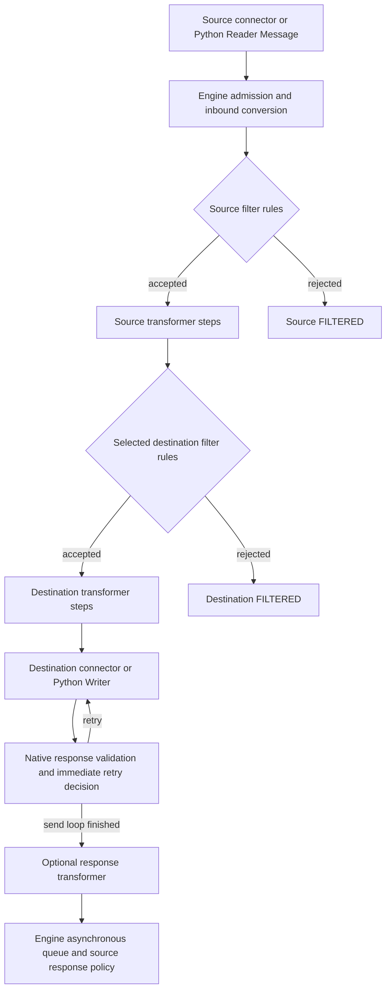

# Contexts and message flow

Python source runs in a managed CPython worker, while the engine retains responsibility for channel admission, filtering, transformation, destination dispatch, response handling, queues, and retries. Choose the editor that owns the operation: a filter decides acceptance, a transformer changes documents, a Reader produces messages, a Writer performs a destination operation, and a Python Function supplies a value to its JavaScript caller.

Start at [Home](Home.md), or use [JavaScript to Python](JavaScript-to-Python.md) for syntax translations. This page defines what exists at each execution point; [Filters and transformers](Filters-and-transformers.md) gives document-editing examples.

## Eight editors, five worker contracts

The eight source surfaces are two filters, three transformers, Reader, Writer, and Python Function. These are not eight interchangeable ways to return a message.

Every surface receives `logger`, `phase`, read-only `message` metadata, `globalMap`, `globalChannelMap`, and read-only `configurationMap`. The per-message maps below mean `channelMap`, `connectorMap`, read-only `sourceMap`, and `responseMap`. See [Maps and values](Maps-and-values.md) for map semantics and supported values.

| Editor | When it executes | `phase` | Additional variables | Output contract |
| --- | --- | --- | --- | --- |
| Source filter: Python rule | During source filtering, before source transformer steps | `source-filter` | `msg`, `has_tmp`, optional `tmp`, per-message maps | Return exactly `True` or `False`; empty/fallthrough accepts; valid document/map edits also apply |
| Destination filter: Python rule | During that destination's filtering, before its transformer steps | `destination-filter` | Same as source filter | Same boolean contract; rejection skips this destination |
| Source transformer: Python step | At its position among source transformer steps, after a successful source filter | `source-transformer` | `msg`, `has_tmp`, optional `tmp`, per-message maps | Mutate or replace `msg`/`tmp`; no top-level `return` |
| Destination transformer: Python step | At its position among that destination's steps, after a successful destination filter | `destination-transformer` | Same transformer variables | Mutate or replace `msg`/`tmp`; no top-level `return` |
| Destination response transformer: Python step | When the engine runs that destination's response transformation | `response-transformer` | Transformer variables plus `response` | Edit response documents and supported `response` fields |
| Python Reader | Once per engine poll | `reader` | Writable invocation-local `sourceMap`; no other per-message maps or documents | `None`, one `Message`, or bounded list of `Message` |
| Python Writer | When the engine invokes that destination send attempt | `writer` | `payload`, per-message maps; no `msg` or `tmp` | `None`, string, `Status`, or `Response` |
| Python Function template | Only when a JavaScript filter/transformer explicitly calls its deployed function | Calling transformer phase, as detailed below | `arguments`, per-message maps; no `msg`, `tmp`, or `response` | Return a JSON-compatible value |

`tmp` is absent from the Python globals when the engine supplies no outbound template. Test `has_tmp` before using it. The stock filter/transformer builder can initialize the template before filtering, so filters can see it; they still execute before transformer steps populate its fields.

The table describes executed, enabled surfaces. Disabled rules or steps do not execute. Python rules and Python steps nested inside stock Iterator elements are unsupported. Use a flat Python rule/step and a Python `for` loop instead.

### Python Functions called from filters

A Python Function is an explicit bridge callable from JavaScript; it is not a helper automatically injected into Python scripts. Its `phase` is `source-transformer`, `destination-transformer`, or `response-transformer`. A function called from a **JavaScript source filter** still sees `source-transformer`; one called from a **JavaScript destination filter** sees `destination-transformer`. Native Python filter rules themselves see the distinct `source-filter`/`destination-filter` values.

Enable the template's library for the channel and select its supported source/destination filter, transformer, or destination response-transformer contexts. Global/channel deploy, undeploy, preprocessor, postprocessor, and other lifecycle scripts do not gain Python Function support. Readers and Writers cannot call these templates. A context checkbox outside the supported set does not create runtime support.

Functions receive the calling message's maps and metadata, but not its document bindings. Pass documents as arguments and assign the returned value in JavaScript. Their return contract accepts JSON scalar roots, unlike native transformer `msg`/`tmp`, which require an object/array for JSON documents. See [Functions, classes, and modules](Functions-classes-and-modules.md) for library setup and reusable Python code.

## Script execution

Write the script body using the supplied context variables. Filters, Readers, Writers, and Python Functions support ordinary `return`; the runtime handles function execution internally. No named entry point or public `ctx` object is required. A helper function runs only when your statements call it. A `return` exits immediately, and `finally` follows normal Python rules, including cleanup before the return completes. Transformer steps continue to edit `msg`/`tmp`; top-level `return` remains invalid in those steps.

This complete native JSON transformer step assumes `msg` is an object containing a string `name`:

```python
def normalize_name(value):
    return value.strip()

msg["name"] = normalize_name(msg["name"])
```

An unused `def transform(...):` makes no document change. In filters, Readers, Writers, and Python Functions, the authored body executes as a function. An explicit return supplies the output. Filters accept as `True` when the body is empty or execution reaches the end; explicit returns must be boolean, so a bare `return` or `return None` is invalid. Readers, Writers, and Python Functions supply `None` on fallthrough, a bare `return`, or explicit `return None`. `None` emits no Reader messages, produces an empty SENT Writer response, and becomes JSON null for a Python Function.

Script bindings remain available to your helper functions. Definitions in these return-capable contexts execute inside an internal function: do not rely on module-style `__qualname__` or pickling of script-defined classes; put reusable serializable classes in an imported package. `locals()` and `vars()` are not a persistent script-state interface. If dynamic code must define script-global names, use `exec(code, globals())` explicitly.

Script-level variable annotations in these contexts are evaluated when execution reaches them, including on CPython 3.14, unless the script uses `from __future__ import annotations`. Annotations inside your own helpers and classes retain native Python behavior.

Fresh globals do not mean a fresh Python process. Imported modules can remain cached until the worker is recycled. Do not use script globals or module state as durable channel storage, a cross-worker counter, or an external-consumer checkpoint. See [Environments and deployment](Environments-and-deployment.md) for workers and deployed snapshots.

## Where the documents travel

This is a simplified logical flow. Source/destination queues, destination chains, batch processing, response selection, response validation, retries, and connector settings govern the stock engine's actual ordering and timing. It does not promise synchronous execution of every destination or one response-transformer call per incoming message.



JavaScript and Python rules/steps participate in the same stock ordered execution. A preceding JavaScript step's document and map changes are visible to Python; committed Python changes are visible to following JavaScript. Functions execute only at the point where a JavaScript caller invokes them.

### `msg`, `tmp`, and outgoing content

`msg` is the current internal document at that phase. It is not necessarily the original source text or final transport payload. Each source, destination, or response phase has its own datatype/template configuration.

| Current JavaScript document | Python value | Allowed replacement |
| --- | --- | --- |
| JSON object or array | `dict` or `list` | JSON object/array with string object keys and supported JSON values |
| E4X `XML` | Internal XML `str` | Well-formed XML text or `xml.etree.ElementTree.Element` |
| E4X `XMLList` | XML fragment `str`, possibly empty/multiple roots | XML fragment text; rebuilt as `XMLList` |
| RAW string, including stock boxed string | `str` | Another `str` |
| Missing `tmp` | No `tmp` variable; `has_tmp` is `False` | Cannot create a template by assigning `tmp` |

The incoming kind is retained. JSON cannot become RAW by assigning `json.dumps(msg)`; XML cannot become a JSON dict. A null, JSON scalar, unsupported Java/JavaScript object, or missing `msg` is rejected by the native document bridge. Function arguments/results have their separate JSON value contract.

When `tmp` exists, the engine's outbound template is the output document. Editing only `msg` does not automatically copy fields into `tmp`. Populate the template explicitly. Without a template, edit `msg`. The transformer page covers complete examples, XML namespaces, E4X references, and HL7 v2 internal XML.

Writer `payload` is later outgoing **text**, chosen from encoded content first, then transformed content, then raw content. Empty encoded/transformed content is still present and wins over earlier forms. If no content exists, `payload` is `None`. Changing a local `payload` binding does not replace engine content; the Writer uses it as input to its operation and produces a response.

## Metadata is a read-only snapshot

`message` is a mapping, not Java's `connectorMessage`. Use `message["message_id"]` or `.get(...)`, not Java getters. Metadata cannot be used to mutate the engine message. Its keys follow the table below; optional keys should be accessed with `.get`.

| Metadata key | Native filters and transformers, Python Function callers, Writer | Reader |
| --- | --- | --- |
| `channel_id`, `channel_name`, `connector_name` | Available | Available |
| `metadata_id` | Current connector metadata ID | Source connector metadata ID |
| `message_id` | Available for the current engine message | Absent: the poll has not created messages yet |
| `server_id` | Available | Absent |
| `send_attempts` | Engine's current value for this message/phase | Absent |
| `received_date` | ISO instant string only when the engine has a received date | Absent |

Reader `sourceMap` is a fresh writable map containing `pollId`, a generated UUID string for this invocation. Its final entries become defaults for every returned `Message`; each message's `source_map` overrides matching keys. `pollId` is not an engine message ID or an external acknowledgment token. It can be overridden and is `"sample"` in synthetic Test. There is no `poll` script global or documented poll timestamp field. Synthetic editor Test supplies sample metadata and does not prove that live Reader metadata contains message identity; see [Editor testing and troubleshooting](Editor-testing-and-troubleshooting.md).

For example, this complete Writer script assumes a text payload and simply reports an accepted response; it performs no external delivery:

```python
from oie_python import Response, Status

logger.info("message=%s destination=%s attempt=%s",
            message["message_id"], message["metadata_id"], message["send_attempts"])
return Response(status=Status.SENT, data="accepted", status_message="Recorded")
```

## Response document versus Writer `Response`

These surfaces have different responsibilities:

| Operation | Response transformer | Python Writer |
| --- | --- | --- |
| Read/edit response body | Use current `msg` and optional `tmp`, according to response datatypes | Produce `Response(data=...)` or a string result |
| Change status | `response.status = "ERROR"` | `return Status.ERROR` or `Response(status=...)` |
| Set short status text | `response.status_message = "..."` | `Response(status_message="...")` |
| Set error detail | `response.error = "..."` | `Response(error="...")` |
| Replace helper binding | Rebinding `response` has no effect on captured response fields | Return the desired object |

The response-transformer helper exposes only `status`, `status_message`, and `error`; it has no `.data` or Java `.getMessage()` API. The body travels through `msg`/`tmp`. Supported assigned statuses are `SENT`, `ERROR`, and `QUEUED`. Text fields accept strings or `None`. The imported `Response` class is a Writer result type, not a replacement response-transformer helper.

A bare Writer string, even `"ERROR"`, is **successful response data**, not a status request. `Status.ERROR` is the explicit status-only result. `None` means SENT with empty data. A Writer dict/bytes result is invalid: serialize JSON yourself. Queue-disabled `QUEUED` becomes an engine ERROR; queue and retry behavior still follows stock destination settings. See [Connectors](Connectors.md) for full Reader/Writer contracts.

## Validation, commits, and limits of rollback

Each invocation works with serialized documents and map snapshots. The worker executes the script, extracts its output, and validates supported values. The Java bridge validates document kinds, XML/JSON, response fields, and every map operation before applying changes. For native steps/rules, the JavaScript wrapper constructs both replacement document objects before committing map deltas and replacing the document/response bindings.

An exception, invalid filter boolean, malformed XML, unsupported result, unsafe number, or other contract failure applies no staged document/map/response changes **from that invocation**. That is not a transaction spanning all rules, steps, functions, or external services. A previous successful invocation stays committed when a later invocation fails. A valid false filter result also commits that rule's edits. Logs and external I/O cannot be rolled back.

Map snapshots do not refresh while Python is running. Changed keys commit after successful validation; unrelated concurrent keys are preserved, while competing writes to the same key are last-writer-wins. Counters implemented as read/increment/write are not atomic. Use external transactional storage when that distinction matters.

Reader validation precedes the first dispatch, but dispatching a valid list is not atomic: a later admission failure retains earlier messages. Writer delivery can have an uncertain outcome if an external operation succeeds before a timeout. Stock retry/reprocessing may call the Writer again. The toolkit does not silently replay an invocation on a replacement worker. Design external acknowledgment and idempotency explicitly; see [Connectors](Connectors.md).

## Source and verification references

The public baseline is [SDK contract](../sdk.md). The source of the actual globals and extraction contracts is [SDK context implementation](../../python-sdk/oie_python/_context.py); script execution is in [worker](../../python-sdk/oie_python/worker.py). The [generated wrappers](../../shared/src/main/java/com/mirth/connect/plugins/python/PythonContract.java), [Python bridge](../../server/src/main/java/com/mirth/connect/plugins/python/server/PythonBridge.java), [Reader adapter](../../server/src/main/java/com/mirth/connect/plugins/python/server/PythonReceiver.java), and [connector conversions](../../server/src/main/java/com/mirth/connect/plugins/python/server/Connectors.java) define live phase, metadata, and content behavior.

See [testing and support](../validation.md) for maintained suites and qualification limits.
