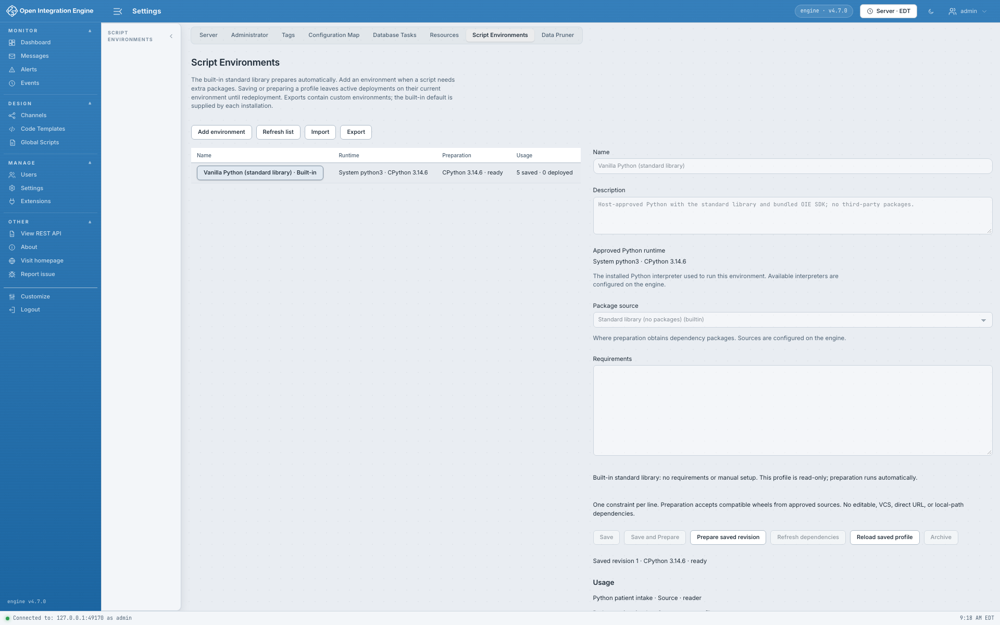

# Environments and deployment

[Wiki home](Home.md) · [Operator configuration](../operations.md) · [Classes and packages](Functions-classes-and-modules.md)

## What a Script Environment selects

A Script Environment is a saved dependency profile: an approved interpreter ID, an approved package source ID, and requirements. Preparation resolves compatible wheels, records a hash lock, and builds a private environment containing those dependencies and the toolkit SDK. A script selects a profile by UUID, not by its display name.

| Term | Meaning |
| --- | --- |
| Runtime | The operator-approved CPython executable on the engine node |
| Package source | The approved index or local wheelhouse used during preparation |
| Profile | The saved environment definition and its revision |
| Lock | The resolved dependency versions and hashes |
| Prepared artifact | The node-local environment built for the interpreter/ABI/platform and SDK identity |
| Deployed binding | The captured script and prepared environment used by a particular channel deployment |

An environment controls dependencies; it does not add another context's globals. A Writer using the same environment as a transformer still receives `payload`, not `msg`. Two profiles can contain the same package without sharing Python objects or state.

## Built-in vanilla environment

**Vanilla Python (standard library)** has no third-party requirements. It installs only the bundled SDK into a private environment and prepares automatically without package downloads. It uses an approved CPython interpreter already installed on the node. With the default policy this resolves `python3` from the engine process's PATH, which may differ from your interactive shell.

The actual interpreter version is displayed in the UI. Runtime code requires CPython 3.9 or later with `venv` and `ensurepip`; use syntax and packages compatible with the selected interpreter. The toolkit does not bundle an operating-system interpreter. Current worker process supervision requires a supported POSIX environment; Windows execution is unavailable. See [testing and support](../validation.md) for qualified combinations rather than inferring qualification from a version minimum.

The vanilla definition is protected. Create a separate profile for additional packages or another interpreter selection. New scripts default to vanilla. A missing/null legacy profile reference also selects the built-in default; a nonempty unknown UUID does not silently fall back to it.

## Script Environments screen



The **Script Environments** screen brings together the saved profile, runtime and package-source selections, requirements, preparation state, and usage. Check readiness on the node that will execute the script before selecting the profile and deploying a channel.

## Custom packages

1. Ask the operator to make the required runtime and package source available if they are not already listed. Local executable paths and package credentials belong in operator policy, not channel source.
2. In **Settings → Script Environments**, create a profile and select its runtime/source.
3. Add package requirements. Pin versions when repeatable promotion matters.
4. Save, then prepare the saved revision. Follow the preparation output until readiness is **Ready** on the executing node.
5. Select the profile in each consuming Python editor. Validate and sample-test the scripts, then deploy the channels.

Example requirement for the included package, after its wheel is available in the approved source:

```text
oie-channel-helpers-example==0.1.0
```

Normal requirement constraints, extras, environment markers, comments, and blank lines are supported. The package policy requires binary wheels. Source distributions, editable installs, VCS/direct URLs, local-path requirements, and pip directives are rejected. Do not use `--index-url`, `--find-links`, or credentials in the requirements field. The bundled `oie_python` SDK is managed by the toolkit, not supplied as a competing dependency.

Offline wheelhouses need all compatible transitive wheels for the target Python and platform. A native wheel may still depend on operating-system libraries installed by the operator. Preparation cannot turn a wheel for another interpreter or architecture into a compatible one. See the [operator guide](../operations.md) for source and interpreter configuration.

Package code runs as trusted channel-author code with the engine service account's filesystem and network access. A prepared environment is dependency isolation, not a security sandbox. Imports execute when scripts run; editor analysis and compile-only validation do not execute them.

## Save, prepare, and deploy are separate operations

| Change | Necessary follow-up | Existing deployed channel |
| --- | --- | --- |
| Python rule, step, Reader, or Writer source | Save channel and redeploy | Keeps captured source until redeploy |
| Python Function source/name/context/library inclusion | Save templates/libraries and redeploy each affected channel | Keeps captured functions until redeploy |
| Requirements or runtime/source selection | Save profile, prepare, redeploy consumers | Keeps prior prepared environment while its binding remains active |
| New versions available within an unchanged requirement range | Refresh dependencies, prepare as directed, redeploy | Does not automatically adopt newer packages |
| Interpreter, source policy, or toolkit SDK identity changes | Re-establish readiness on each executing node, then redeploy | Do not assume the old artifact is valid for new deployment |
| Stop/start the channel | No new preparation solely for stop/start | Retains the same deployment binding |
| Undeploy/redeploy the channel | Resolve a new deployment snapshot | Retires the old binding; in-flight ownership governs cleanup |

Preparing an unchanged definition reuses its existing dependency lock. **Refresh dependencies** requests a new resolution. Saving or preparing does not hot-reload running code. A process restart alone is not a package promotion strategy; prepare and deploy the intended revision explicitly.

Enabled native Python filters, steps, Readers, and Writers must bind to valid source and a ready environment. Python Functions have a deliberate difference: an unavailable function can be captured with a failure reason while the channel deploys; invoking it then fails. A successful channel deployment therefore does not prove that every optional function is callable. Validate and invoke the functions your workflow needs.

The plugin checks deployment identity and rejects stale or mismatched calls. Concurrent template saves during compilation can reject deployment; complete those saves and retry. Engine deployment itself is not a transaction over arbitrary JavaScript deploy-script effects. See [deployment boundaries](../operations.md#deployment-boundaries).

## Workers, timeouts, and concurrency

Each bound Python script has a worker pool. Workers can be reused, evicted, recycled, or terminated. Script globals are fresh per call; imported modules may remain cached in a worker. Do not rely on the next message using the same process. Context values are snapshots, and map read/modify/write sequences are not atomic across workers or destinations.

| Default limit | Value |
| --- | --- |
| Execution workers per node | 8 |
| Workers per channel | 8 by default; separately configurable |
| Waiting acquisitions | 64 |
| Worker acquisition deadline | 5 seconds |
| Worker startup deadline | 10 seconds |
| Script invocation timeout | 30 seconds, configurable per script |
| Operator maximum invocation timeout | 5 minutes |
| Protocol frame size | 16 MiB |
| Reader messages per poll | 1,000 |
| Captured output per invocation | 64 KiB |
| Idle worker eviction | 60 seconds |
| Worker recycling | After 1,000 calls |
| Concurrent preparation / preparation deadline | 1 job / 10 minutes |
| Concurrent sample tests | 2 |

These are configurable initial resource limits, not throughput promises. A frame includes serialized data and encoding overhead, so a nominal 16 MiB binary message does not fit into a 16 MiB frame. See [Maps and values](Maps-and-values.md) for value limits and [operations](../operations.md#initial-limits) for setting names.

An acquisition failure can occur before user code starts. A timeout or transport failure after execution starts can leave an external operation's outcome uncertain. The toolkit does not silently replay the invocation on a replacement worker. The engine's own Writer retry/queue behavior can still repeat delivery. Use target-supported idempotency and durable source checkpoints; do not implement duplicate suppression using a non-atomic shared-map counter.

Do not leave background threads, subprocesses, or callbacks doing message work after your script completes. Those operations have no continued engine invocation context and are not acknowledged by the returned result. Implement bounded synchronous work, with client timeouts shorter than the enclosing script timeout where practical.

## Promotion, imports, and multiple nodes

Channel XML stores environment UUID references; it does not embed interpreters, installed dependencies, or complete profiles. Export/import profiles through the plugin and map conflicts explicitly on the target. Export includes matching saved locks when present; it does not offer a separate include-lock toggle. A similarly named profile does not satisfy a different UUID automatically.

Registry definitions and locks are persisted. Readiness, workers, preparation jobs, paths, and credentials are node-local. Prepare custom profiles on every node that can execute the channel. Vanilla prepares automatically on each starting node; repeated automatic failures are bounded, and explicit cancellation keeps that generation stopped until retry or a new generation.

Use node-affine connections for preparation, jobs, logs, validation, and sample tests. Otherwise a load balancer can send a follow-up request to a node that does not own the job or artifact. Treat the UI's node identity and readiness as part of the operation.

Profile edits use epoch/revision checks. On a conflict, reload and reconcile the draft. If a persistence response reports an uncertain outcome, reconcile the same request identity before creating another mutation. The UI/API receipts are bounded; they are not an indefinite transaction log.

Archiving is blocked by known saved references or active preparation; saved disabled rules/steps and unassigned saved templates can still count. Deployed environment leases protect artifacts still in use. Removing a reference from one editor does not establish that an environment is unused everywhere.

For whole-server restores, quiesce plugin API activity, restore, prepare on target nodes, and redeploy. During plugin service startup, quiesce profile writes on other nodes because the host's generic property rewrite precedes plugin-controlled transactions. Use the [operator recovery guide](../operations.md#nodes-backups-and-conflicts) for these boundaries, backup policy, cleanup, and permissions.

Implementation references: [environment preparation](../../server/src/main/java/com/mirth/connect/plugins/python/server/PreparationManager.java), [deployment capture](../../server/src/main/java/com/mirth/connect/plugins/python/server/Deployments.java), [worker pools](../../server/src/main/java/com/mirth/connect/plugins/python/server/WorkerPools.java), [operator defaults](../../server/src/main/java/com/mirth/connect/plugins/python/server/OperatorConfig.java), and [requirements policy](../../server/src/main/java/com/mirth/connect/plugins/python/server/Requirements.java).
